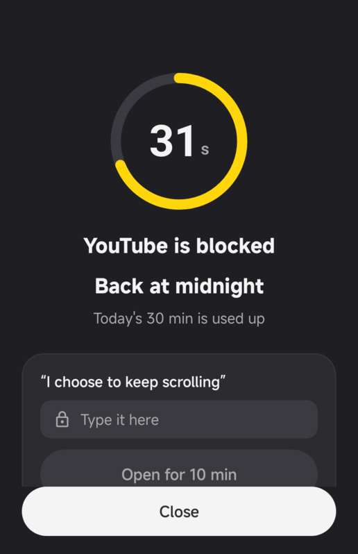
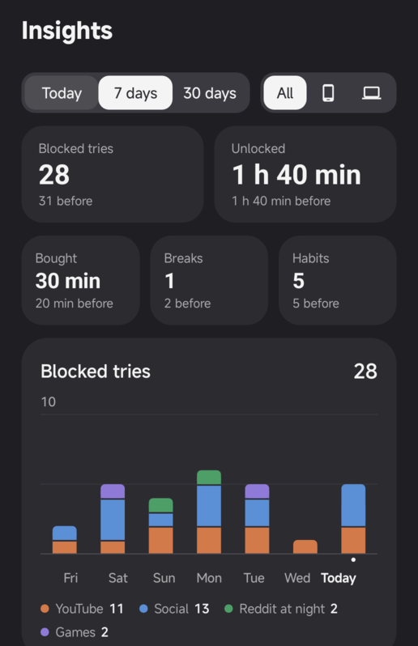
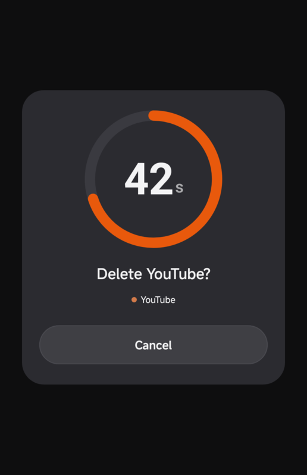
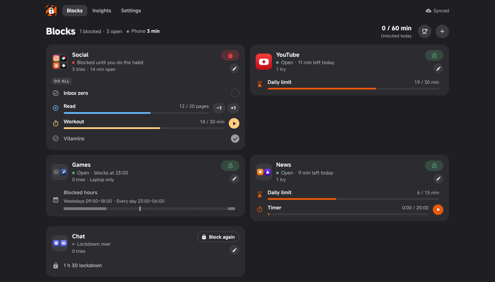
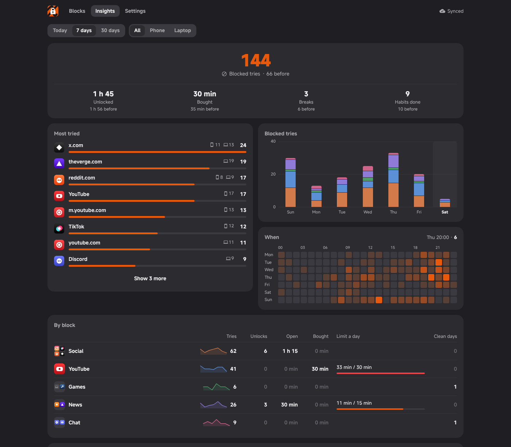
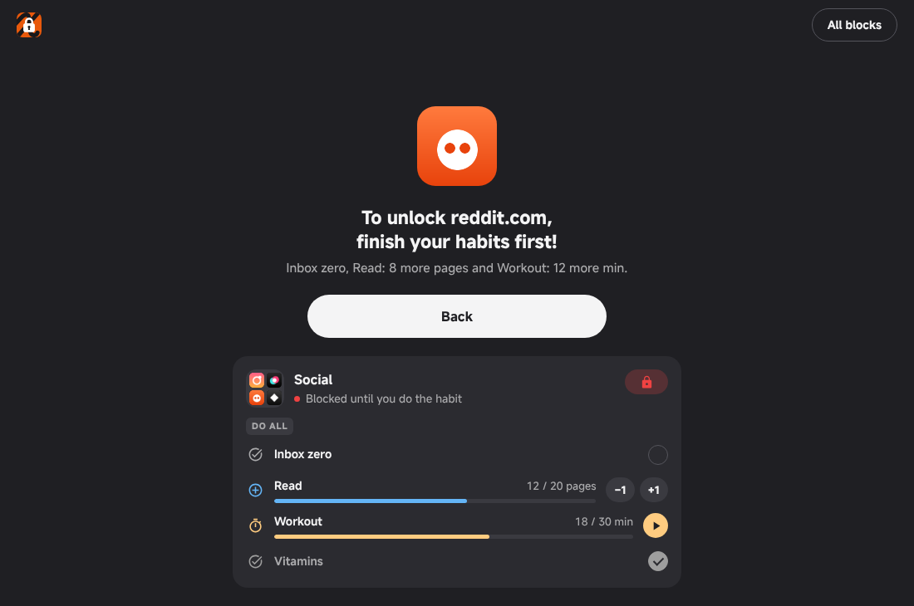
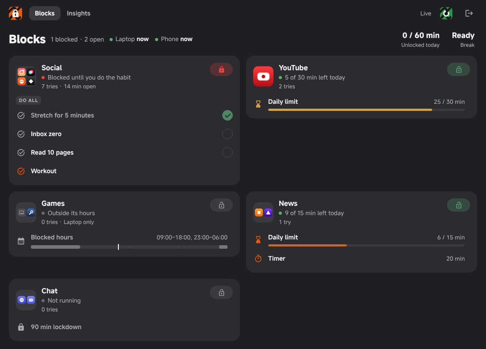
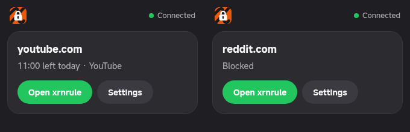
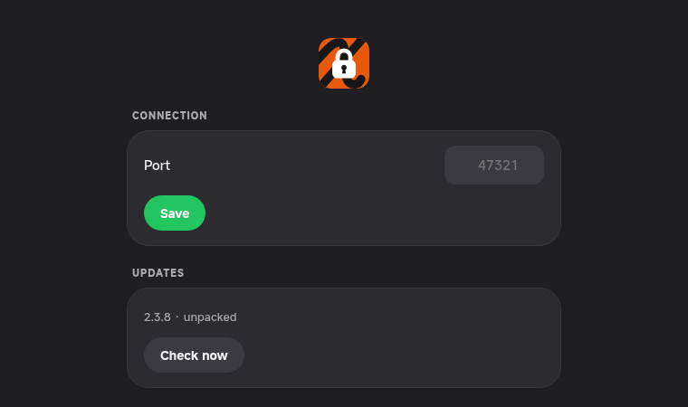

<p align="center">
  
</p>

<h1 align="center">xrnrule</h1>

Rules for your phone and your laptop. Distracting apps and websites stay behind a block until
you've done a habit, used up today's minutes, or are inside the hours you set; then they open
for a while and lock again on their own. No accounts, no cloud: everything stays on the phone,
unless you turn on sync with a server of your own, which also brings the same blocks to a
Linux laptop. (The one other thing asked of the internet: each website you name is asked for
its own icon, once a month at most, never through an icon service that would see the list.)

xrnrule was called xrnhabit until 24 Oct 2026, when it took in
[xrnfocus](https://github.com/Xernnn/xrnfocus), a browser extension that put time limits on
sites. One set of rules now covers apps and sites on both devices.

Phone app 0.2.20 (build 20), browser extension 2.3.8.

## Screenshots

All of them show made-up blocks, habits and history.

<table>
<tr>
<td width="33%"></td>
<td width="33%"></td>
<td width="33%"></td>
</tr>
<tr>
<td>The block screen over a limited app: today's 30 minutes are used up, and a few more can be bought after a 45-second wait and a typed sentence.</td>
<td>Insights for the last 7 days, from both devices: blocked tries, time unlocked, minutes bought, breaks and habits, against the week before.</td>
<td>Deleting a block, or making one easier, waits 60 seconds first.</td>
</tr>
</table>



The laptop's own page (`127.0.0.1:47321`), Blocks tab: each block with the icons of what it covers,
how it stands, its day so far, and what opens it (tasks, habits with a bar and a play button for
a timer, a daily limit's minutes, today's blocked hours).



Insights on the laptop: the same figures as the phone's, with the most tried apps and sites by
their icons.

<table>
<tr>
<td width="50%"></td>
<td width="50%"></td>
</tr>
<tr>
<td>Where a blocked site or laptop app lands, with what's left to do before it opens.</td>
<td>The sync server's status page: the blocks both devices share, live, and when each device last checked in.</td>
</tr>
</table>

<table>
<tr>
<td width="50%"></td>
<td width="50%"></td>
</tr>
<tr>
<td>The extension's toolbar popup on a limited site (what's left today, and of which block) and on a blocked one.</td>
<td>The extension's settings: the port xrnrule listens on, and where updates come from.</td>
</tr>
</table>

## How it fits together

```
Phone                                        Laptop (Hyprland or KDE Plasma 6)
 xrnrule app: rules, apps, habits             xrnrule-desktop: rules, desktop apps, its page
   ↑ 127.0.0.1:47321                            ↑ 127.0.0.1:47321
 Quetta + the xrnrule extension: sites        Zen or a Chromium browser + the extension: sites
              \                               /
   your home server: xrnrule-sync (server/): blocks, unlocks, minutes used, bought minutes,
                     history, logos, the status page and updates
                     xrnloops-sync (from xrnloops): habits and their ticks
```

A block is about a thing, not a device: a "YouTube" block can cover the phone app,
youtube.com in both browsers and a laptop app. It holds on the phone and the laptop, or only on
one of them (**Blocks on**); the other device still shows it and can unlock it. A block asks one
or more of these:

1. **Earn it.** Blocked until you do what it asks:
   - tick a task, or do a habit (a check, or an amount such as 20 pages);
   - a **focus session**: a timer habit, run on the phone's full-screen timer (a ring filling toward
     today's goal, with pause, a five-minute break and end) or from the play button on the laptop's
     page;
   - minutes in a *different* app, such as a reading app, or a plain wait timer;
   - a habit **linked** to [xrnloops](#habits-and-xrnloops), so only a real tick there counts;
   - an **NFC tag** stuck somewhere out of reach (the kitchen, the gym bag): holding the phone
     to it opens the block from any screen. A new tag is read twice, since some cards show a new
     id on every read.

   An unlock lasts the minutes you set (**Block again after**), as a timer or as minutes of use
   over the day (**Self paced**). All unlocks together give at most an hour a day (Settings →
   Unlocks), counted across both devices.
2. **Limit.** N minutes a day, N opens a day, and/or "at most N minutes in a row, then a break".
   Coming back within a minute is the same open. Optionally a few seconds' pause before each
   open, showing what's left; it opens by itself, and leaving first costs nothing. Phone and
   laptop share one limit, or each gets its own (a choice per block).
3. **Set time.** Blocked on a weekly schedule (as many time windows as you like), or locked
   down right now for N minutes. A Quick Settings tile starts every lockdown block without
   opening the app, then shows the time left; it can't stop one.

A habit block can also have a daily limit and blocked hours of its own, and a limit block can
have blocked hours; whichever rule is holding wins, and a habit only opens its own part. With a
habit and a daily limit you choose what comes first: **Limit first** (the free minutes go first,
then the habit opens it again) or **Habit first** (blocked until the habit is done, and the limit
stays on top). A lockdown stands alone.

A thing can be in several blocks; whichever is strictest right now wins. A block can leave
parts of a site alone (music.youtube.com under youtube.com).

**Ways through a block**, the same on the phone and the laptop:

- **Do the habit** (Earn-it blocks): it opens on both devices.
- **Buy a few minutes** (Limit and Set-time blocks): start, wait 45 s, type "I choose to keep
  scrolling", get a few minutes. Twice a day per block by default, counted across both devices.
  Never past a lockdown, a hardcore block, a lock or a forced break.
- **The daily break**: 15 minutes off every soft block, once a day.

## What else it does

- **Hardcore mode** (sideload build). A password gate on Android Settings (and phone-maker
  security apps) plus Device Admin anti-uninstall while a hardcore block is active.
- **Hard to talk yourself out of.** Deleting a block or making one easier (including the
  buy-minutes settings) takes a 60-second wait, or the hardcore password. Changing the clock or
  time zone by hand, on the phone or the laptop, doesn't reset limits, move schedules or end a
  lock. The laptop goes by the time zone the phone sets itself.
- **Locks.** A block can be locked for 24 hours up to a year (its edit page): until then nothing
  that makes it easier to get past can change, on the phone or the laptop, whatever you wait or
  type. Bought minutes and the daily break don't get past it either, not even ones already
  running; a habit still opens it. Making it stricter still works. Five emergency unlocks, shared
  by both devices and never given back, can end a lock early.
- **Status at a glance.** The notification shows what's open and for how long, warns 30 s
  before an unlock ends, and says so if blocking stops working. On limited sites the extension
  can show a corner clock of what runs out first, and warns at 10, 5, 3 and 1 minutes left.
- **Corner timer.** Inside an app with a limit or an unlock, the time left sits faintly in a
  corner. It stands out for a few seconds at 10, 5, 3 and 1 minutes left, and for the last 30
  seconds. Settings → Corner timer moves it, sizes it, sets how faint it is or turns it off.
- **App lock.** Opening the app, or coming back to it after 30 seconds away, asks for your
  fingerprint (or the phone's screen-lock PIN). The block screen isn't behind it: that's how you
  get through a block. Settings → Security & privacy → App lock turns it off. Android 9 or later.
- **Tells you about updates** (sideload build). New versions come from your server, at the sync
  address and with its login. A new one downloads by itself, then a notification and a banner on
  the Blocks tab say it's ready and take you to Settings → Updates, where it installs when you tap
  Install. See [Updates](#updates).
- **Backup.** Export your blocks to a file and import them on a new install.
- **Real logos everywhere.** With sync on, each device sends the server the logos of what its
  blocks name: the phone its apps' own icons (and a site's where the server has none), the
  laptop its apps' icons (from their `.desktop` entries and the icon theme) and its sites'. So
  the laptop's page and the server's status page show the phone's apps as they look on the
  phone. At most 64 KB each and 400 in all; a logo goes again only when it changed, at most once
  a day.
- **Insights.** Both devices' history (the laptop's comes through the sync server), for today,
  7 or 30 days, all devices or one: blocked tries, time unlocked, minutes bought, breaks and
  habits, each over the same figure for the stretch before (once the log reaches back to its
  first day); tries per day (per hour on Today) stacked by block, each column's split shown on
  hover or tap, and when in the week they come; the most tried apps and sites, and on which
  device; a row per block (tries and their trend, unlocks and time open, minutes bought, a daily
  limit's use a day against it, clean days in a row); on the phone, time per app and site; and a
  day-by-day history. A block has a muted tone from its place in the block list, shown only small:
  a dot before its name, its part of a bar or a day's strip, its sparkline. A habit or an unlock
  both devices logged counts once.
- **The laptop's pages** (the laptop app's own page and the server's status page, which the hub's
  laptop window shows as Blocks) look and work like the phone's. A block's card has the real
  icons of what it covers (one alone, or four in a 2 × 2 with "+N"), its name, how it stands in
  grey words after a coloured dot and its day so far ("4 tries · 12 min open"); at the right, a
  padlock for its state, or its one allowed action (open an earned unlock, block it again after a
  lockdown): never an on/off switch. Then "DO ALL" and a row per thing it asks for, in the
  habit's own colour where the laptop knows it, with a thin bar and a round play button for a
  timer; today's blocked hours as a strip with now marked. Insights leads with the blocked tries
  big and the other figures under them, then the most tried apps and sites by their icons; By
  block and the history show icons too. The laptop's block page shows the site's or app's icon,
  "To unlock reddit.com, finish your habits first!" and what's left. Icons come from the phone,
  the laptop and the sites themselves through the server (`/icons`); what has none shows a grey
  globe, phone or laptop. The status page says when each device last checked in, the laptop's
  page when the phone did.
- Built to survive reboots, process death and OEM battery killers, and it tells you when the phone
  turns its autostart off, which Xiaomi phones do at every install.

## On the laptop

`desktop/` is a small JVM daemon, `xrnrule-desktop` (a systemd user service), that runs the same
engine as the phone. It closes blocked laptop apps (Steam, Discord, …), answers the browser
extension, and serves its own page on `127.0.0.1:47321`: Blocks, Insights and Settings, where
blocks can be made and edited much as on the phone, and the block page where blocked apps and
sites land. It learns which window is in front from Hyprland's event socket, or from a KWin script
on KDE Plasma 6. `desktop/install.sh` builds it, installs it to `~/.local/share/xrnrule-desktop`
and starts the service; `~/.config/xrnrule/desktop.properties` names the server and the login.
Everything else (popups, the phone going quiet, troubleshooting, looking at the page on made-up
data) is in [desktop/README.md](desktop/README.md).

## The sync server and its status page

`server/xrnrule-sync.py` is one Python file (standard library plus `bcrypt`) that runs on your own
server behind HTTPS, under a path such as `/xrnrule`. It keeps no logic of its own:

- **The shared state**, one JSON document per user (`GET`/`PUT /state`): blocks, tasks, unlocks,
  each device's minutes used, bought minutes, settings, locks. Each device merges three ways on
  its side and writes back with `If-Match`, so two devices can't overwrite each other. The laptop
  long-polls it, so it hears of the phone's changes as soon as they're written.
- **History** (`POST`/`GET /events`, `GET /limits`): blocked tries, habits, unlocks, bought
  minutes and breaks from both devices, and each limit's use a day, kept 120 days, for Insights
  and the weekly review in the habits web app.
- **Logos** (`/icons`), **check-ins** (`/devices`) and **releases** (`/update/…`: the extension's
  signed `.crx`, the phone app's `.apk`; see [Updates](#updates)).
- **The status page** (`/`): the blocks both devices share, live, with Insights, after one
  sign-in (see [Security](#security)).

Logins come from an htpasswd file of bcrypt hashes; the same file and session key can serve
xrnloops-sync, so one sign-in covers both web pages. `server/deploy.sh [ssh host]` tests the server,
copies the program and its `web/` folder to a Termux + runit host together, restarts the
service and waits for `/health`. The full list of endpoints is at the top of
`xrnrule-sync.py`.

## The browser extension

Websites are blocked by the extension in `extension/`, not by reading the screen: nothing in
xrnrule uses Accessibility, which banking apps refuse to run next to. The extension asks
xrnrule on the same device (`127.0.0.1:47321`) what to do and decides nothing itself. It sends
a blocked site to the block page before it loads, moves open tabs off a site the moment it's
blocked, and while xrnrule doesn't answer it keeps blocking what it last heard was blocked. After
a minute without xrnrule it blocks every site that has a rule, so stopping the app or the laptop
daemon isn't a way past a limit; opening it again brings everything back.

A rule can cover one part of a site: `youtube.com/shorts` blocks Shorts and leaves the rest of
YouTube alone, and a page moving there without loading anew is caught too. A page playing sound
behind another one, or with the screen off, counts against its limit. **Block other browsers**
(on by default) keeps browsers without the extension closed while a block has websites. Turning
that off takes the usual wait.

On the phone, a blocked tab turns into a small page the app serves itself, and the app's block
screen covers the browser only while that tab is the one in front. **Leave this site** (or
Back) closes the block screen at once and steps the tab back to where you were, or closes it if
it has nothing to go back to, so the rest of the browser stays yours.

- **Laptop (Helium or another Chromium browser):** extensions page → Developer mode → Load
  unpacked → `extension/`. It reloads itself whenever that folder's `manifest.json` names a new
  version (a pull, or a release).
- **Laptop (Zen, Firefox 140 or newer):** `about:debugging` → **This Firefox** → **Load Temporary
  Add-on…** → `extension/manifest.json` (or the `.zip` from `scripts/pack-extension.sh`; Firefox
  takes it as an `.xpi`). Firefox drops a temporary add-on when it closes; to keep it, sign the
  zip with an unlisted upload to addons.mozilla.org, or, in a build that allows unsigned add-ons,
  set `xpinstall.signatures.required` to `false` in `about:config` and install the file. If the
  toolbar popup says **No site access**, click **Allow** (Firefox can withhold or revoke an
  extension's site access in `about:addons`). There is no self-update
  there: a temporary add-on still reloads when its folder's version changes, an installed `.xpi`
  updates by installing a newer one.
- **Phone (Quetta):** open `https://<your server>/xrnrule/update/xrnrule.crx` in Quetta →
  **Download anyway** → **OK** (or hand the file to its extensions page: Developer mode → "(from
  .zip/.crx/.user.js)"). From then on it fetches each new version from your server by itself.
  A copy installed from a `.zip` (`scripts/pack-extension.sh`) works too, but never updates, and
  each one gets a new extension ID, so remove it before installing the `.crx`.

The toolbar popup shows the site in front and what xrnrule says about it (blocked, what's left
today and of which block, or no rule), whether xrnrule is answering, and a way into it. The
extension's settings page has its one setting, the port xrnrule listens on, and shows its version
and where it updates from, with **Check now**.
The phone app warns when the browser the extension lives in goes quiet, without ever blocking
that browser, since that's where you'd fix it. On the laptop, a browser with the extension turned
off is closed after two minutes in front, and so is one that withholds the extension's site access
(Chromium's "Site access: on specific sites" or "On click", Zen's switches in `about:addons`:
the extension then stops talking to xrnrule), or whose window in front the extension can't
see: a private window it isn't allowed in, or another profile without it. Browsers can't be seen
inside other apps: a page opened in an app's own in-app browser isn't blocked.

## Updates

`node scripts/release.mjs` publishes both halves to your server; `… extension` or `… app` does
one. It only runs on `main` with everything committed (`--force` overrides that). It bumps the
version past what the server already has, since a browser or phone only takes a newer one, so
bump it in a commit first. It needs `~/.config/xrnrule/release.json`:

```json
{ "server": "https://<your server>/xrnrule", "ssh": ["<ssh host>", "<another way in>"] }
```

- **The extension** is signed with `~/.config/xrnrule/extension.pem`, made on the first release
  (`--new-key`; without it a missing key stops the release). **Back it up.** The key is the
  extension's identity: an update signed with another one is refused, and the phone would have to
  install afresh under a new ID.
- **The app** is the sideload release build, signed with the key it shares with xrnloops
  (`../xrn-signing.properties`; the release refuses to go without it, since the phone only takes
  an update signed like the app it has). On the phone, Settings → Updates → **Allow installing
  updates** once. A new build downloads by itself every few hours; a notification and a banner on
  the Blocks tab then open Settings → Updates, and nothing installs until you tap **Install**
  there. The first build with the updater has to be installed
  by hand: `./gradlew :app:installSideloadRelease`, or open
  `https://<your server>/xrnrule/update/xrnrule.apk` on the phone and sign in with the sync login.
- **The laptop daemon** has no updater: `desktop/install.sh` again, from an up-to-date checkout.

## Security

- **Only the sync server is on the internet.** The phone app and the laptop daemon answer on
  `127.0.0.1:47321` and nowhere else. Every change needs an `X-Xrnrule` header, which other
  websites can't add (a CORS preflight that is never approved), and the request must name that
  address as its Host, which shuts out DNS-rebinding pages too. The laptop's pages can't be put
  in another site's frame and run no scripts but their own.
- **Website icons** are fetched over HTTPS from each named site itself (its home page's
  `<link rel="icon">`, then `/favicon.ico`), with no login and no cookies, and only for real
  domain names, never an IP address or `localhost`. Only PNG, ICO, JPEG, GIF and WebP are
  kept, checked by their first bytes (no SVG: on the laptop page's origin it could carry script).
  The sync server keeps the devices' logos (`/icons`) under the same rule: a raster image of at
  most 64 KB, its type told by its bytes, under a key that can't name a path, served with
  `nosniff`, a sandboxing policy and to its own origin only. Being an ``, the status page's
  logo asks with its login cookie alone; nothing else does.
- **Other apps on the phone** can reach `127.0.0.1:47321` as well. They can read which sites are
  blocked and report a site in front, nothing more, and nothing they send can crash the app.
  If xrnrule were down and another app took the port, the extension would still send blocked
  sites only to its own block page or one on `127.0.0.1:47321`, never to a page that app names.
- **The sync server** (behind Tailscale Funnel, HTTPS) wants the login for every byte of data.
  Ten wrong passwords from one address in 15 minutes lock that address out; the address is the
  one Funnel saw, not a header the caller could forge. Uploads are capped at 8 MB, unpacked or
  not.
- **The web pages** (this status page and the xrnloops habits page, on a host shared with
  other apps) trade the password for a 30-day cookie that no script can read, and keep nothing
  else: a script bug anywhere on the host can't walk off with the password. The cookie only
  counts with a header other sites can't send, and a new password ends every session. The
  pages run only their own scripts and can't be put in another site's frame.
- **Updates** can only come from you. The server takes no releases over HTTP (they arrive over ssh),
  the extension's files are public because a browser's updater sends no login (it's the
  extension's own code, nothing of yours), and the app's need the sync login. A browser takes
  only a `.crx` signed with the extension's key, and Android only an APK signed with the app's;
  the app also checks the hash, package and build number before installing.
- **The app lock** keeps the app's screens to whoever can unlock the phone. It's a door, not a
  vault: blocks are enforced by the service, which doesn't wait for it.
- **Secrets** stay where they're used: the sync password in the phone app's private storage
  (never backed up) and in a file only you can read on the laptop. The hardcore password exists
  only as a salted hash on the phone and is never synced or exported.
- **Install the release build on the phone** (`installSideloadRelease`). The debug build is
  debuggable, so any computer you've allowed USB debugging can read the app's files, the sync
  password among them.

## Build

Requirements: **JDK 17 or newer** (Gradle 9.8 runs on 17 through 27; everything is built
for Java 17 whatever the JDK) and the Android SDK (platform 35, build tools 36). Point Gradle at
the SDK with `local.properties` (`sdk.dir=…`) or `ANDROID_HOME`. The server needs Python 3 with
`bcrypt`, the extension's and the pages' tests Node 22.

```sh
./gradlew :domain:test                 # engine unit tests (pure JVM)
./gradlew :desktop:test                # the laptop daemon (end to end only with python3 + bcrypt and ../xrnloops beside this repo)
./gradlew :app:testSideloadDebugUnitTest   # the phone app's unit tests
./gradlew :app:assembleSideloadDebug   # full build, with hardcore mode
./gradlew :app:assemblePlayDebug       # Play-safe build: no Device Admin
./gradlew :app:installSideloadDebug    # build and install on a connected device
./gradlew :app:installSideloadRelease  # the build to live with: not debuggable
python3 -m unittest server/test_xrnrule_sync.py   # the sync server
node --test extension/test             # the extension's helpers and its signed .crx
node --test server                     # the status page's reading of the shared state, Insights
node --test desktop/src/test/js        # the laptop page
scripts/smoke.sh                       # the block screen on an emulator of its own, end to end
desktop/install.sh                     # build and (re)start the laptop daemon
server/deploy.sh                       # test and deploy the sync server and its page
node scripts/release.mjs               # publish the extension and the app; see Updates
scripts/pack-extension.sh              # the extension as a .zip, loaded by hand (never updates)
```

CI (`.github/workflows/ci.yml`) runs the three Gradle test tasks, the server's tests and the
extension's and status page's Node tests on every push.

The phone app's screens can be drawn without a phone:
`app/src/debug/kotlin/com/xern/xrnrule/app/ui/Previews.kt` holds Compose previews on made-up data
(`android preview render "?:app@sideloadDebug"`). The laptop's
page runs on made-up data with `./gradlew :desktop:demo --args="<port> <empty dir>"` (see
[desktop/README.md](desktop/README.md#working-on-the-page)).

The two flavors exist because the distribution channel is undecided: anti-uninstall uses
Device Admin, which carries Play Store policy risk, so the `play` build leaves it out.

Minimum Android version: 8.0 (API 26).

## Permissions

Usage access (to see the foreground app), draw over other apps (the block screen),
notifications, and exemption from battery optimization. On Xiaomi/MIUI also enable
autostart. NFC only if a block asks for a tag. The Settings screen shows what's missing and
links to each one. Sites need the browser extension (above); the app only listens for it on
`127.0.0.1`.

## Habits, and xrnloops

Habits live on your server's habit service (xrnloops-sync, from xrnloops, a GPLv3 fork of
[Loop Habit Tracker](https://github.com/iSoron/uhabits)). xrnrule
on the phone and on the laptop, xrnloops and the habits web page all read and write the same
habits and ticks there, so a habit ticked anywhere opens the blocks that ask for it everywhere.
Amounts logged on two devices at once add up; nothing needs to be installed next to xrnrule.

xrnloops stays the habit tracker (its list, habit screens, reminders and widgets) and xrnrule
the blocker; they work together through the habit server. xrnrule keeps its own copy of the
habits, with Loop's rules for scores, streaks and automatic ticks in `:domain`, so blocks can ask
for a habit on the laptop too. xrnloops tells xrnrule the moment something is ticked in it (a
signature-protected broadcast, so both apps must be signed with the same key), and xrnrule asks
it to sync every half hour, raising an alert when it doesn't answer.

## Project layout

| Module | |
|---|---|
| `:domain` | The rules engine: a pure Kotlin state machine with no Android dependencies, fully unit-tested |
| `:app` | Compose UI, the foreground service that enforces blocks, the extension's door, persistence, permissions |
| `:hardcore` | Device Admin receiver (sideload builds only) |
| `:desktop` | The laptop daemon, its page and its KWin script; see [desktop/README.md](desktop/README.md) |
| `extension/` | The browser extension, for both devices |
| `server/` | `xrnrule-sync.py`, the tiny sync server (Python), its status page (`web/`) and `deploy.sh` |
| `scripts/` | Releases (`release.mjs`, `crx.mjs`), the packed extension, the emulator smoke test |

The engine's rules (states, transitions, invariants I1–I54, multi-device sync in §2.4, the
habit server in §2.5) are specified in `docs/domain-contract.md`, which is in Vietnamese.

## What it's modelled on

The phone app's screens, and since November 2026 the laptop's pages, follow Habits First, a
phone app that keeps apps blocked until you've done your habits: the block cards with their logo
clusters and padlocks, "DO ALL" and the habit rows, the block form, "Block again after" and
self-paced unlocks, and the block screen's "finish your habits first!". None of its code or
artwork is in this repo. Where xrnrule goes its own way: one set of blocks shared by the phone,
a Linux laptop and their browsers; websites through an extension, never Accessibility; habits
shared with xrnloops; and your own server instead of an account.

## License

xrnrule is free software under the GNU General Public License, version 3 or later; see
[LICENSE](LICENSE). Parts of it are ported from [Loop Habit Tracker](https://github.com/iSoron/uhabits)
(also GPLv3), copyright Álinson Santos Xavier and its contributors; those files say so at the
top. The font is Xiaomi's MiSans (Latin), under its own licence.
